# Cahier des charges — PromoManager

Moteur de promotions B2B pour commerces
Édité par **Marne Tech** — Version 2.0

## Suivi des modifications

| Version | Rédaction | Description | Date |
|---|---|---|---|
| V1.1 | Marne Tech | Cahier des charges initial (contexte, besoin, périmètre, user stories) | Octobre 2026 |
| V2.0 | Marne Tech | Restructuration : rôles détaillés, fonctionnalités priorisées par module, règles de gestion, cas d'usage et modèle de données en annexe | Octobre 2026 |

---

## Sommaire

- [Préambule](#préambule)
- [1. Présentation du projet](#1-présentation-du-projet)
- [2. Périmètre du projet](#2-périmètre-du-projet)
- [3. Contraintes techniques, fonctionnelles et organisationnelles](#3-contraintes-techniques-fonctionnelles-et-organisationnelles)
- [4. Planning prévisionnel](#4-planning-prévisionnel)
- [5. Livrables attendus](#5-livrables-attendus)
- [6. Maintenance, évolution, support](#6-maintenance-évolution-support)
- [7. Annexes](#7-annexes)

---

## Préambule

Ce document est réalisé dans le cadre de l'évaluation RNCP 35419 — Niveau 7 (Expert en Ingénierie du Logiciel), bloc de compétences « Intégration, industrialisation et déploiement du logiciel ». Il formalise le besoin, le périmètre et les contraintes du projet **PromoManager**, point de départ de la conception (voir [document de conception](../conception/conception.md)) et non un contrat figé : le détail évolue au fil des sprints (voir méthodologie en section 3.6).

## 1. Présentation du projet

### 1.1 Contexte

La digitalisation des commerces de proximité et du e-commerce s'accompagne d'une demande croissante d'outils marketing simples pour fidéliser la clientèle : programmes de points, codes de réduction, cartes cadeaux. Beaucoup de commerçants ne disposent pas des ressources techniques pour développer ces mécaniques en interne, et peinent notamment à reconnaître un même client lorsqu'il achète tantôt en boutique, tantôt en ligne.

**Marne Tech**, startup éditrice de solutions SaaS, souhaite répondre à ce besoin en proposant **PromoManager**, un moteur de promotions B2B piloté depuis un dashboard unique, déployable sans développeur, et ouvert via une API permettant l'intégration avec les CMS e-commerce existants (Shopify, WordPress, etc.).

### 1.2 Objectifs

Le projet est divisible en deux temps :

- **Livrer le MVP de PromoManager** couvrant les quatre leviers de fidélisation (compte, fidélité, codes promo, cartes cadeaux) pilotables depuis un dashboard marchand unique, avec un espace client en lecture.
- **Industrialiser la livraison** : pipeline CI/CD, conteneurisation, couverture de tests, documentation de déploiement — le projet sert aussi de support à l'évaluation des compétences d'intégration et de déploiement logiciel.

Le client cible (commerçant e-commerce ou boutique physique) exprime les besoins suivants :

- Récompenser automatiquement mes clients réguliers par un système de points de fidélité.
- Lancer rapidement des campagnes de réduction ciblées (codes promo) sans développement spécifique.
- Proposer des cartes cadeaux à la vente et en automatiser l'encaissement.
- Donner à mes clients un accès autonome à leurs avantages (solde de points, historique, cartes cadeaux).
- Reconnaître un même client et cumuler ses avantages quel que soit le canal d'achat (boutique physique ou site en ligne).
- Piloter l'ensemble depuis une seule interface, avec une mise en service rapide.

## 2. Périmètre du projet

### 2.1 Rôles

| Rôle | Description |
|---|---|
| **Marchand** | Commerçant (e-commerce ou boutique physique) qui utilise PromoManager pour fidéliser sa clientèle. Il configure le programme, crée des campagnes et gère ses clients. Compte créé en self-service. |
| **Client** | Client final d'un marchand. Il bénéficie des points, codes promo et cartes cadeaux, et consulte ses avantages via l'Espace Client. Son compte est **provisionné par le marchand** (ex. première attribution de points), puis **activé** par le client lui-même. |
| **Marne Tech (éditeur / support)** | Équipe en charge du développement, de la maintenance et du support de la plateforme. Accès technique à l'infrastructure, hors périmètre applicatif Marchand/Client. |

*Point d'attention : le périmètre v1 ne prévoit qu'un compte marchand unique par enseigne (pas de multi-boutiques, voir § 2.2) ni de rôle d'administrateur applicatif distinct du marchand — ce dernier gère déjà l'intégralité de ses réglages.*

### 2.2 Fonctionnalités

#### Module Compte

| Id | Fonctionnalité | Description | Priorisation |
|---|---|---|---|
| F01 | Création de compte marchand | Interface self-service pour créer un compte et configurer les réglages globaux (couleurs, taux de conversion) | important |
| F02 | Connexion au Dashboard | Authentification sécurisée du marchand (identifiant/mot de passe) | important |
| F03 | Provisionnement de compte client | Création d'un compte client par le marchand (ex. lors d'une première attribution de points) | important |
| F04 | Activation de compte client | Le client active l'accès provisionné et définit son mot de passe | important |
| F05 | Connexion à l'Espace Client | Authentification sécurisée du client | important |

#### Module Fidélité

| Id | Fonctionnalité | Description | Priorisation |
|---|---|---|---|
| F06 | Définition du taux de conversion | Le marchand fixe la valeur d'un point (ex. 1€ = 1 point) | important |
| F07 | Attribution de points | Attribution manuelle ou via API, indépendamment du canal (boutique ou en ligne) | important |
| F08 | Notification email automatique | Email envoyé au client à chaque attribution de points | important |
| F09 | Consultation solde et historique de points | Vue client du solde courant et des transactions passées | important |

#### Module Codes promo

| Id | Fonctionnalité | Description | Priorisation |
|---|---|---|---|
| F10 | Création d'un code promo | Mécanique (pourcentage, montant fixe, BOGO), limite d'utilisation, date d'expiration | important |
| F11 | Suivi des conversions en temps réel | Statistiques d'utilisation d'un code pour le marchand | important |
| F12 | Désactivation d'un code promo | Le marchand peut désactiver un code avant son expiration | important |
| F13 | Application d'un code promo | Le client saisit un code valide pour bénéficier d'une réduction | important |

#### Module Cartes cadeaux

| Id | Fonctionnalité | Description | Priorisation |
|---|---|---|---|
| F14 | Génération d'une carte cadeau | Création d'une carte (montant, numéro) par le marchand | important |
| F15 | Achat d'une carte cadeau | Paiement via Stripe (mode test), inclut systématiquement F15-bis | important |
| F15-bis | Paiement via Stripe | Sous-étape obligatoire de l'achat d'une carte cadeau | important |
| F16 | Consultation du solde d'une carte cadeau | Vue client du montant disponible | important |

#### Dashboard (transversal)

| Id | Fonctionnalité | Description | Priorisation |
|---|---|---|---|
| F17 | Tableau de bord marchand | Point d'entrée regroupant la configuration et la supervision des 4 modules ci-dessus | important |

#### Évolutions futures identifiées (hors v1, à chiffrer séparément)

| Id | Fonctionnalité | Description | Priorisation |
|---|---|---|---|
| F18 | Expiration configurable des points | Durée de validité paramétrable des points de fidélité | non-prioritaire, phase 2 |
| F19 | Gestion multi-boutiques | Plusieurs points de vente distincts rattachés à un même compte marchand, avec statistiques par boutique | non-prioritaire, phase 2 |
| F20 | Intégrations natives CMS / caisse | Connecteurs prêts à l'emploi (Shopify, WordPress, logiciels de caisse) | non-prioritaire, phase 2 |
| F21 | Commission plateforme | Commission prélevée par PromoManager sur les ventes de cartes cadeaux | non-prioritaire, phase 2 |
| F22 | Authentification avancée | JWT, SSO, 2FA | non-prioritaire |
| F23 | Application mobile native | Le responsive web couvre l'usage mobile en v1 | non-prioritaire |

**Explicitement hors périmètre v1 :** gestion de catalogue produit ou de stock, paiement en conditions réelles (Stripe reste en mode test).

### 2.3 Règles de gestion

**RG01** — Les données des marchands et des clients ne sont accessibles qu'aux utilisateurs authentifiés et autorisés (conformité RGPD).

**RG02** — Un client est rattaché à un seul marchand ; pas de compte client partagé entre plusieurs marchands dans ce périmètre.

**RG03** — L'attribution de points est indépendante du canal d'origine de l'appel API (caisse boutique ou site e-commerce) : un client est automatiquement reconnu et cumule ses avantages dès lors que les deux canaux appellent la même API PromoManager rattachée à son marchand.

**RG04** — Un code promo ne peut être appliqué que s'il est à l'état `ACTIF`, non expiré, et si son nombre d'utilisations n'a pas atteint la limite définie.

**RG05** — Une carte cadeau générée par le marchand n'est utilisable par le client qu'après confirmation du paiement Stripe (statut de paiement validé).

**RG06** — Le solde de points d'un client ne peut jamais être négatif.

**RG07** — Un compte client reste à l'état `EN_ATTENTE` tant qu'il n'a pas été activé par le client lui-même, même après provisionnement par le marchand (cf. F03 → F04, relation `<<include>>`).

## 3. Contraintes techniques, fonctionnelles et organisationnelles

### 3.1 Étude de l'existant

PromoManager est un projet neuf : il n'y a pas de système existant à reprendre. La stack cible est néanmoins imposée par le cadre de l'évaluation :

| | | |
|---|---|---|
| **Backend** | Langage / Framework | Java + Spring Boot |
| | Base de données | SGBD relationnel |
| | Versionning | GitHub |
| **Frontend** | Framework | Angular |
| | Versionning | GitHub |
| **Paiement** | Fournisseur | Stripe (mode test) |
| **Conteneurisation** | Outils | Docker / docker-compose |
| **CI/CD** | Outils | GitHub Actions, DockerHub (registre d'images) |

Toute proposition technique s'écartant de cette stack devrait être justifiée (contrainte non attendue dans le cadre de cette évaluation).

### 3.2 RGPD / réglementation

L'application doit respecter le RGPD. Les données personnelles des utilisateurs (nom, prénom, email, etc.) doivent être sécurisées, traitées de manière transparente et stockées conformément aux exigences européennes en matière de confidentialité : minimisation des données, finalité explicite, durée de conservation définie.

### 3.3 Écoconception et accessibilité

Le projet privilégie une approche sobre : pas de fonctionnalités superflues hors périmètre v1 (voir § 2.2), architecture simple limitant la consommation de ressources. L'interface responsive (desktop + mobile) doit viser une lisibilité correcte pour le plus grand nombre, sans contrainte légale d'accessibilité dans le cadre de cette évaluation.

### 3.4 Sécurité

- Authentification sécurisée via identifiant/mot de passe, pour le Marchand comme pour le Client.
- Mots de passe stockés de façon sécurisée (hashés).
- Séparation stricte des espaces Marchand (Dashboard) et Client (Espace Client).
- Les données d'un marchand et de ses clients ne sont accessibles qu'aux utilisateurs autorisés (cf. RG01).

### 3.5 Design et expérience utilisateur (UX/UI)

L'interface doit être simple d'usage, adaptée en priorité au desktop (usage marchand en gestion) avec un responsive assurant l'usage mobile (consultation client notamment). Pas de maquette imposée : la simplicité d'usage prime sur la sophistication visuelle.

### 3.6 Cadre de travail à privilégier : Agile

Le développement suit une méthode Agile : découpage en sprints livrant chacun un incrément testable, plutôt que l'application entière d'un coup. Le cahier des charges et le document de conception sont des points de départ, pas des contrats figés : ils évoluent si un besoin a été mal compris, si une contrainte technique impose un compromis, ou si une nouvelle idée apparaît en cours de route.

Workflow retenu : **GitHub Flow** — une branche par ticket (`feature/<numero-issue>-<slug>`), Pull Request vers `main` fermant l'issue au merge, CI verte obligatoire avant tout merge. Suivi via GitHub Issues + GitHub Project (Kanban : Backlog → À faire → En cours → Review → Terminé). Convention de commits : [Conventional Commits](https://www.conventionalcommits.org/).

## 4. Planning prévisionnel

Le projet est découpé selon les questions de l'évaluation RNCP :

| Étape | Contenu |
|---|---|
| Q1 | Cadrage : tableau de suivi des tâches, workflow Git |
| Q2 | Conception : schéma de base de données, script SQL |
| Q3 | Développement : code source des 4 modules + dashboard |
| Q4 | Tests : code source des tests, rapports de couverture |
| Q5 | Industrialisation : pipeline CI/CD, Dockerfiles, docker-compose.yml, documentation de déploiement |

### 5. Livrables attendus

| Question | Document attendu | Contenu clé |
|---|---|---|
| Q1 | Repository | Tableau de suivi des tâches, workflow Git |
| Q2 | Repository | Schéma de la base de données et script SQL |
| Q3 | Repository | Code source |
| Q4 | Repository | Code source des tests et rapports de couverture |
| Q5 | Repository | Pipeline CI/CD, Dockerfiles, docker-compose.yml, readme.md |

## 6. Maintenance, évolution, support

L'objectif principal est de livrer un MVP stable couvrant le périmètre v1 (§ 2.2). Les évolutions identifiées (F18 à F23) sont volontairement reportées pour garantir la livraison dans les délais impartis. Le système doit rester conçu de façon modulaire (un module par levier de fidélisation) afin de faciliter l'ajout de ces fonctionnalités ultérieurement, ainsi que l'évolution de la stack ou de la réglementation applicable.

## 7. Annexes

### 7.1 Cas d'utilisation par module

Les diagrammes détaillés sont disponibles dans [`diagrammes/cas-utilisation/`](../diagrammes/cas-utilisation/) (un fichier par module). Vue de synthèse :

*Pour le détail des échanges Frontend/API/DB de chaque user story, voir les diagrammes de séquence en § 7.4.*

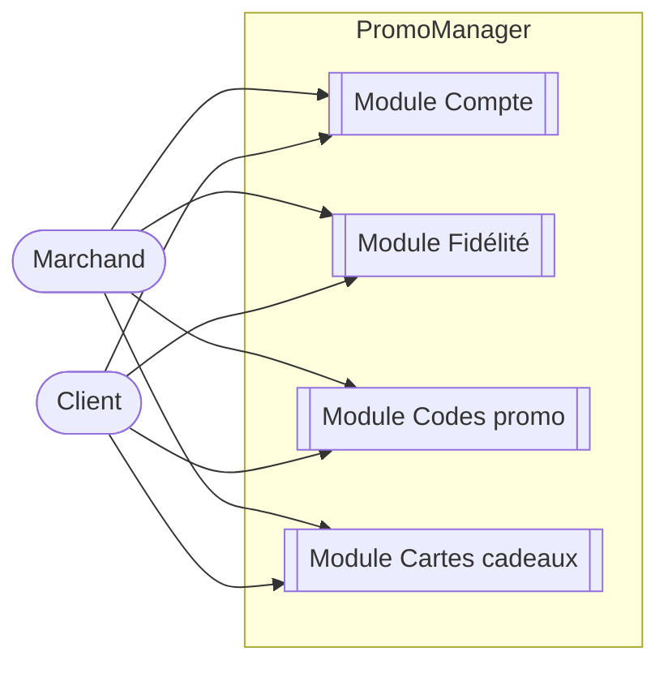

### 7.2 Tableau fonctionnalités ↔ user stories

| Fonctionnalité | Id | User stories |
|---|---|---|
| Création de compte marchand | F01 | US-CPT-01 |
| Connexion au Dashboard | F02 | US-CPT-02 |
| Provisionnement de compte client | F03 | US-CPT-03 |
| Activation de compte client | F04 | US-CPT-04 |
| Connexion à l'Espace Client | F05 | US-CPT-05 |
| Définition du taux de conversion | F06 | US-FID-01 |
| Attribution de points | F07 | US-FID-02 |
| Notification email automatique | F08 | US-FID-03 |
| Consultation solde et historique de points | F09 | US-FID-04 |
| Création d'un code promo | F10 | US-PROMO-01 |
| Suivi des conversions en temps réel | F11 | US-PROMO-02 |
| Désactivation d'un code promo | F12 | US-PROMO-03 |
| Application d'un code promo | F13 | US-PROMO-04 |
| Génération d'une carte cadeau | F14 | US-CADO-01 |
| Achat d'une carte cadeau (+ paiement Stripe) | F15 / F15-bis | US-CADO-02 |
| Consultation du solde d'une carte cadeau | F16 | US-CADO-03 |

### 7.3 User stories détaillées

#### Module Compte

- **US-CPT-01** — En tant que **marchand**, je veux créer mon compte en self-service et configurer les réglages globaux (couleurs, taux de conversion), afin de personnaliser mon programme.
- **US-CPT-02** — En tant que **marchand**, je veux me connecter au Dashboard, afin de gérer mes programmes de fidélité, codes promo et cartes cadeaux.
- **US-CPT-03** — En tant que **marchand**, je veux provisionner un compte pour un client, afin de pouvoir lui attribuer des points dès sa première interaction.
- **US-CPT-04** — En tant que **client**, je veux activer le compte qui m'a été provisionné, afin d'accéder à mon Espace Client.
- **US-CPT-05** — En tant que **client**, je veux me connecter à mon Espace Client, afin de consulter mes avantages.

#### Module Fidélité

- **US-FID-01** — En tant que **marchand**, je veux définir un taux de conversion (ex. 1€ = 1 point), afin de calibrer la valeur de mes points.
- **US-FID-02** — En tant que **marchand**, je veux attribuer des points à un client manuellement ou via l'API, afin de récompenser un achat, quel que soit le canal.
- **US-FID-03** — En tant que **client**, je veux recevoir une notification email quand je gagne des points, afin d'être informé automatiquement de mes avantages.
- **US-FID-04** — En tant que **client**, je veux consulter mon solde et l'historique complet de mes transactions, afin de suivre mes avantages fidélité.

#### Module Codes promo

- **US-PROMO-01** — En tant que **marchand**, je veux créer un code promo avec une mécanique (%, montant fixe, BOGO), une limite d'utilisation et une date d'expiration, afin de lancer une campagne ciblée.
- **US-PROMO-02** — En tant que **marchand**, je veux suivre le taux de conversion d'un code promo en temps réel, afin d'évaluer son efficacité.
- **US-PROMO-03** — En tant que **marchand**, je veux désactiver un code promo avant expiration, afin de me protéger d'un abus détecté.
- **US-PROMO-04** — En tant que **client**, je veux appliquer un code promo valide, afin d'obtenir une réduction sur mon achat.

#### Module Cartes cadeaux

- **US-CADO-01** — En tant que **marchand**, je veux générer une carte cadeau (montant, numéro), afin de la proposer à la vente.
- **US-CADO-02** — En tant que **client**, je veux acheter une carte cadeau en payant via Stripe, afin de l'offrir ou l'utiliser moi-même.
- **US-CADO-03** — En tant que **client**, je veux consulter le solde de ma carte cadeau, afin de savoir combien il me reste à dépenser.

### 7.4 Diagrammes de séquence par user story

Pour chaque user story, le diagramme ci-dessous détaille l'échange entre l'acteur, le Frontend (Angular), l'API (Spring Boot) et la base PostgreSQL (fichiers sources : [`diagrammes/sequence/`](../diagrammes/sequence/), un fichier par module).

#### Module Compte

**US-CPT-01 — Création de compte marchand + réglages globaux**

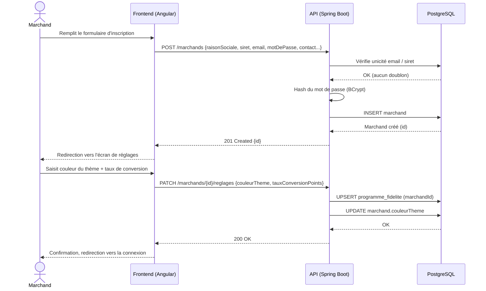

**US-CPT-02 — Connexion au Dashboard**

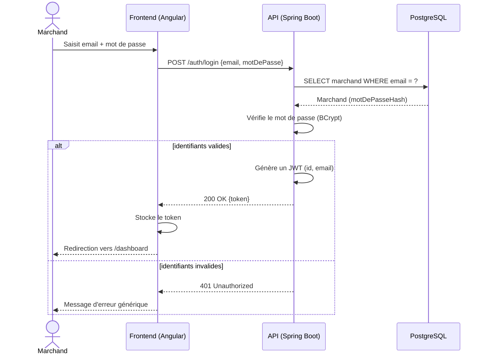

**US-CPT-03 — Provisionnement de compte client**

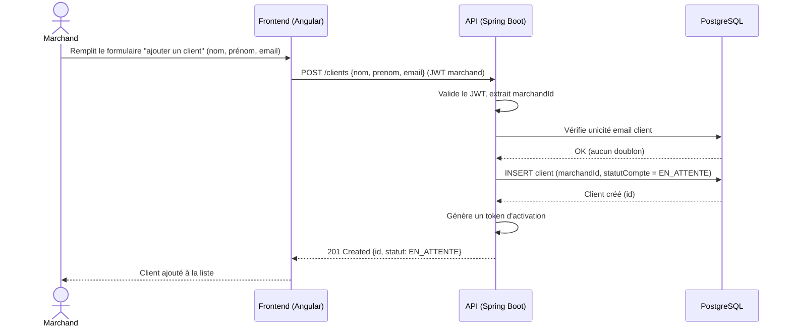

**US-CPT-04 — Activation de compte client**

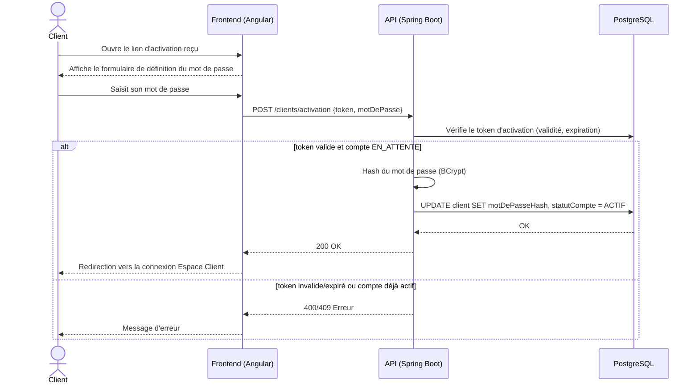

**US-CPT-05 — Connexion à l'Espace Client**

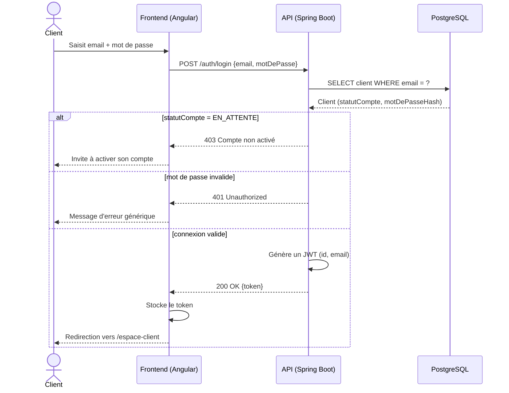

#### Module Fidélité

**US-FID-01 — Définition du taux de conversion**

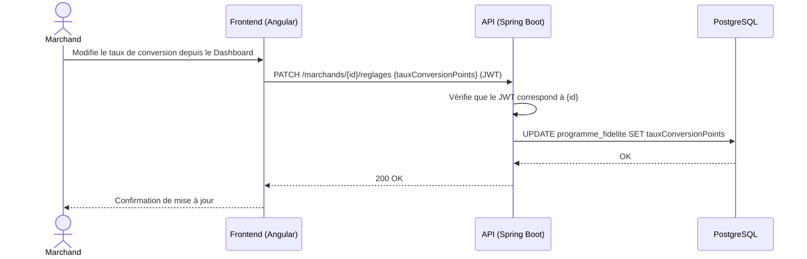

**US-FID-02 — Attribution de points (manuelle ou via API)**

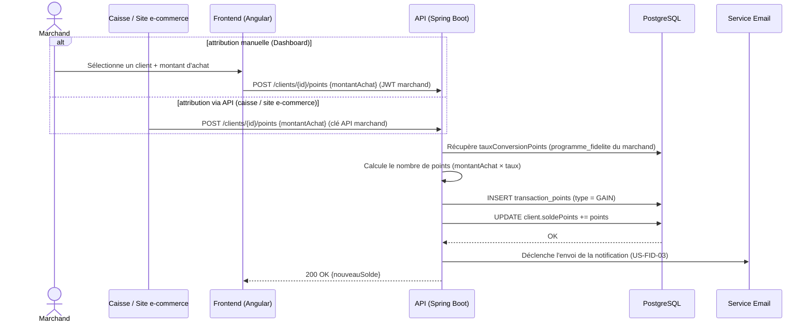

`<<include>>` : l'attribution déclenche systématiquement l'envoi de la notification email (US-FID-03), reprise séparément ci-dessous pour la lisibilité du flux d'envoi.

**US-FID-03 — Notification email automatique**

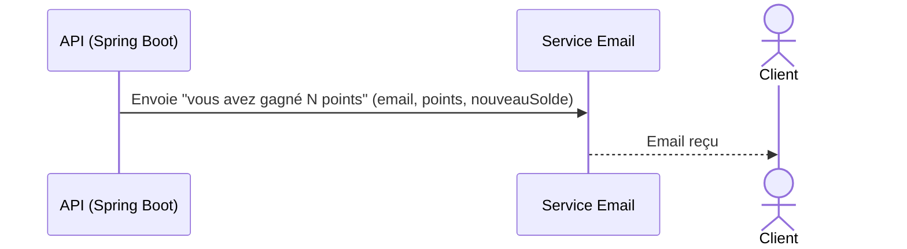

**US-FID-04 — Consultation solde et historique de points**

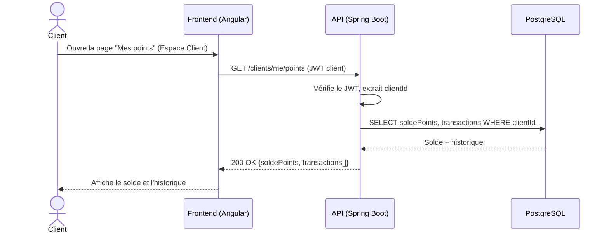

#### Module Codes promo

**US-PROMO-01 — Création d'un code promo**

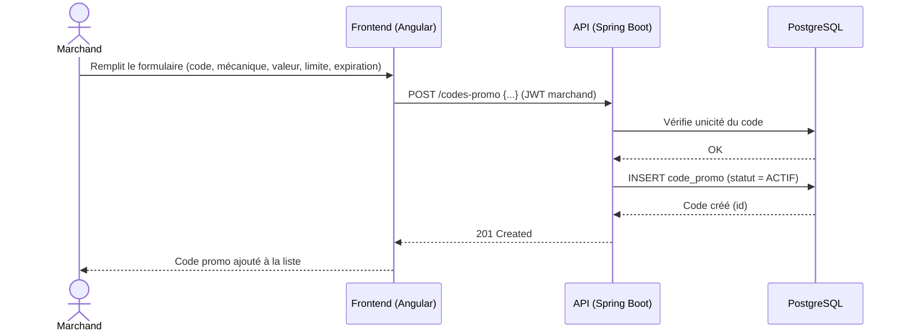

**US-PROMO-02 — Suivi des conversions en temps réel**

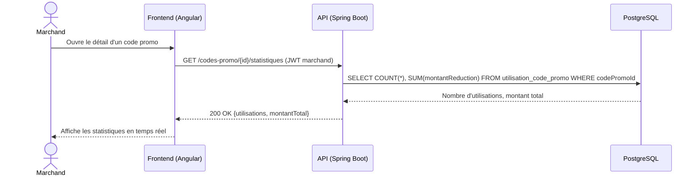

**US-PROMO-03 — Désactivation d'un code promo**

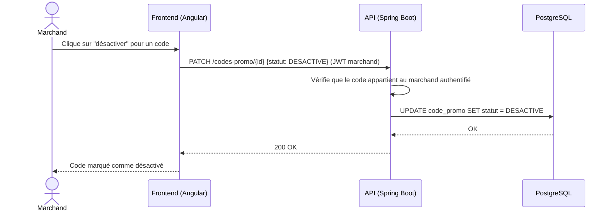

**US-PROMO-04 — Application d'un code promo**

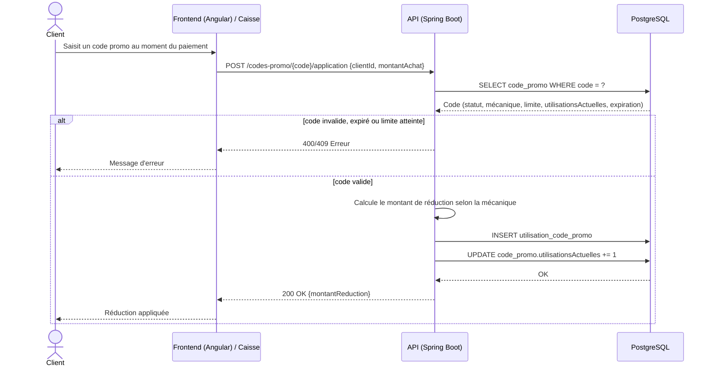

#### Module Cartes cadeaux

**US-CADO-01 — Génération d'une carte cadeau**

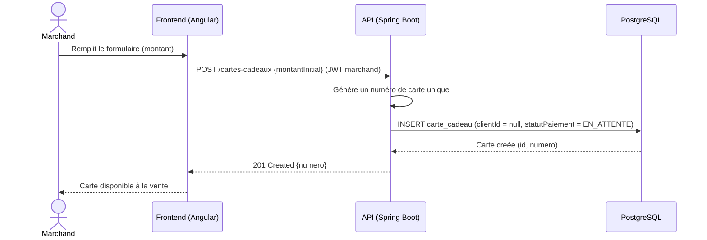

**US-CADO-02 — Achat d'une carte cadeau en payant via Stripe**

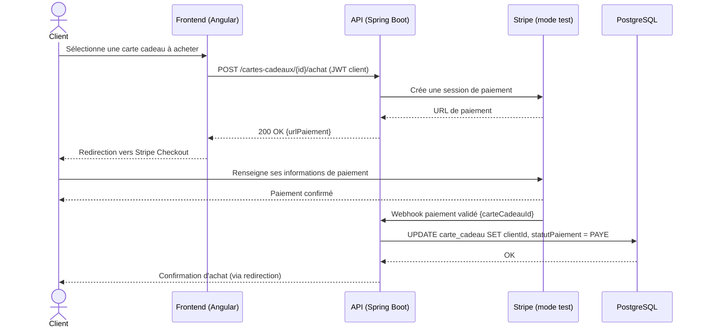

`<<include>>` : l'achat d'une carte cadeau implique systématiquement un paiement Stripe — c'est une sous-étape obligatoire du flux, matérialisée ici par l'échange avec Stripe et son webhook de confirmation.

**US-CADO-03 — Consultation du solde d'une carte cadeau**

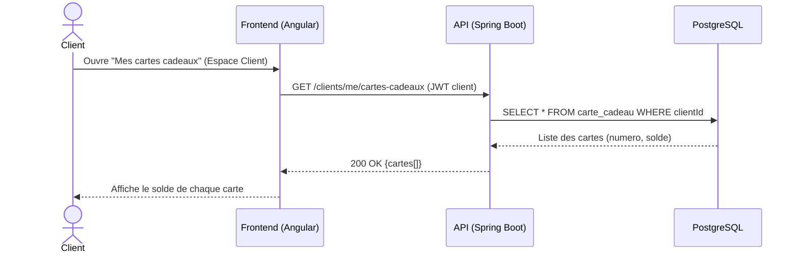

### 7.5 Modèle de données

Diagramme entité-relation et dictionnaire de données détaillés : voir [document de conception, § 8 et § 9](../conception/conception.md#8-modèle-de-données).

### 7.6 Maquettes

Aucune maquette graphique n'est imposée pour ce projet (§ 3.5) ; l'interface est construite directement en Angular au fil des sprints, sans charte graphique spécifique.
