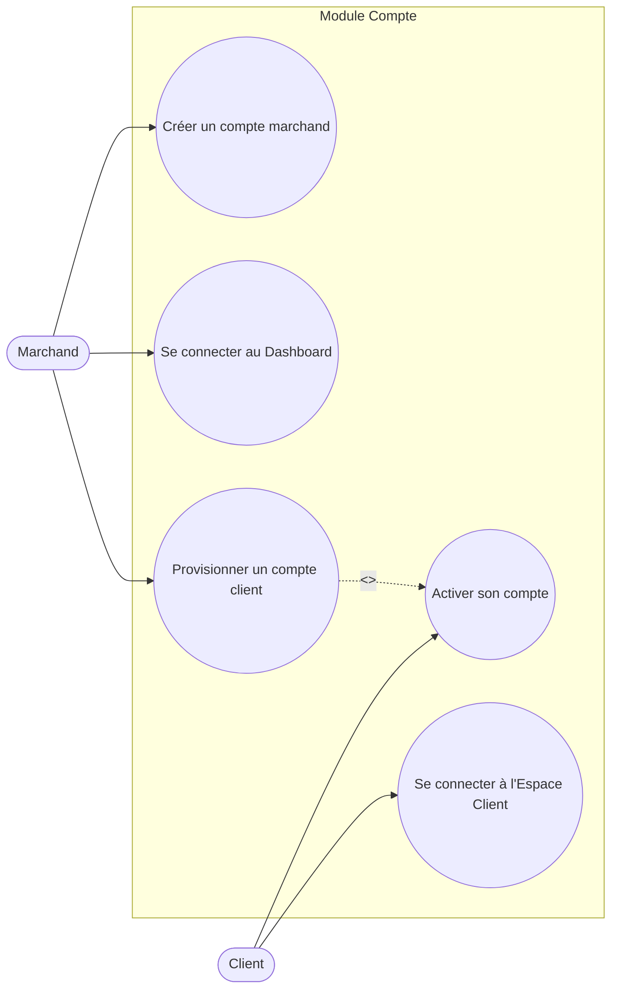
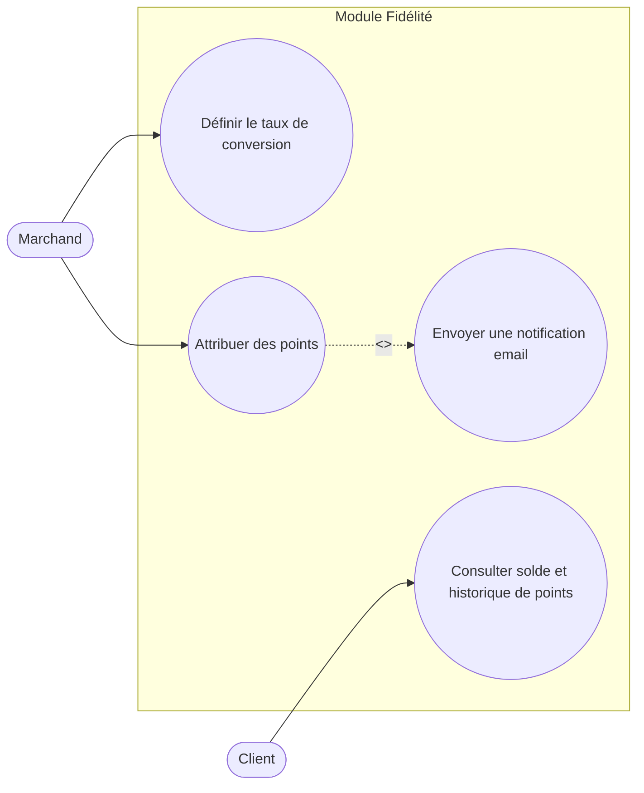
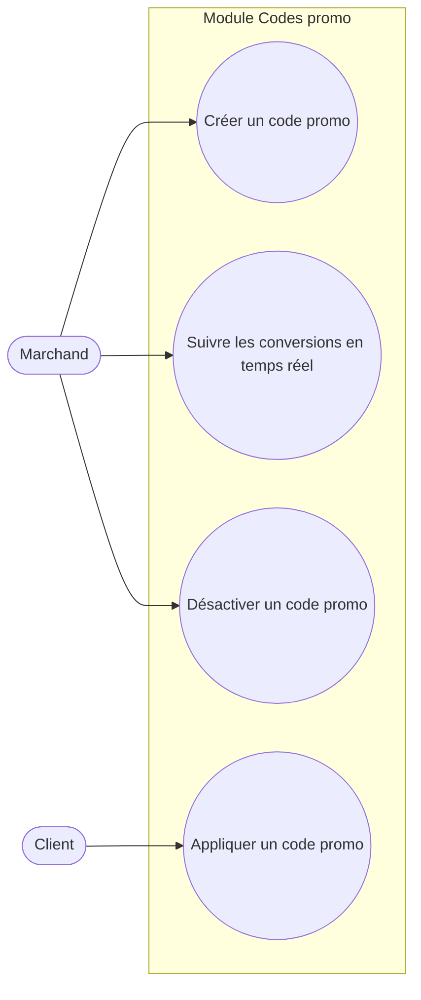
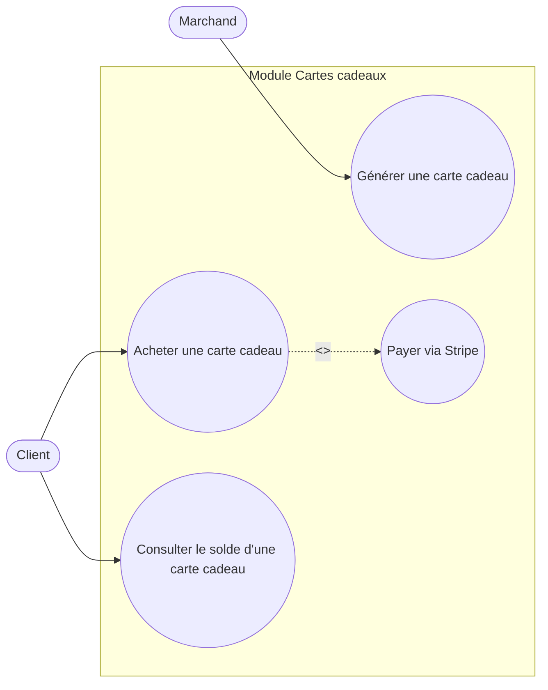
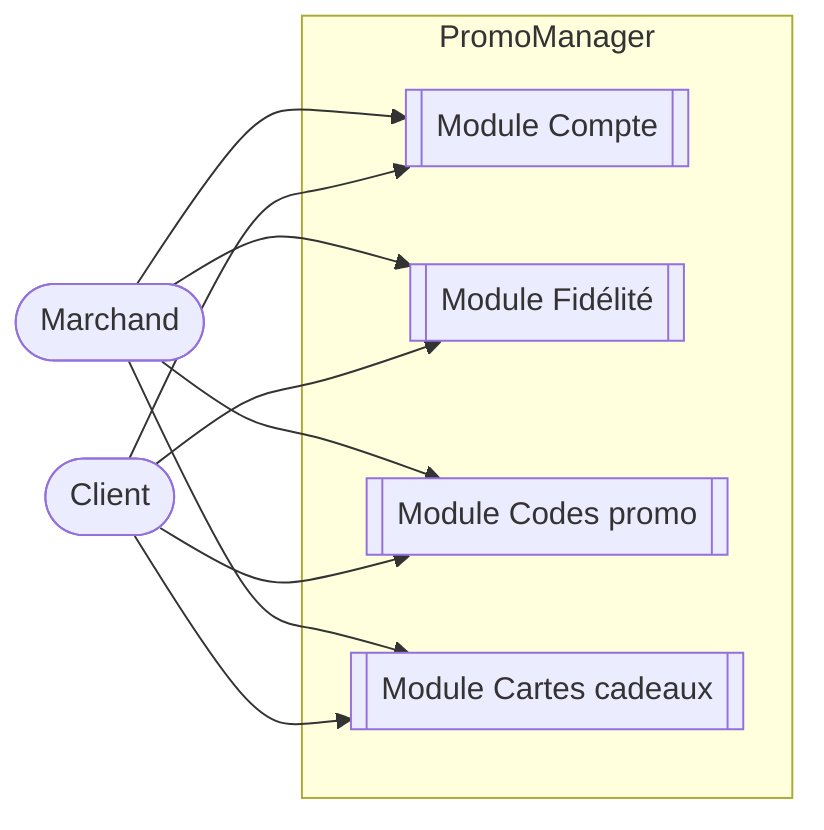
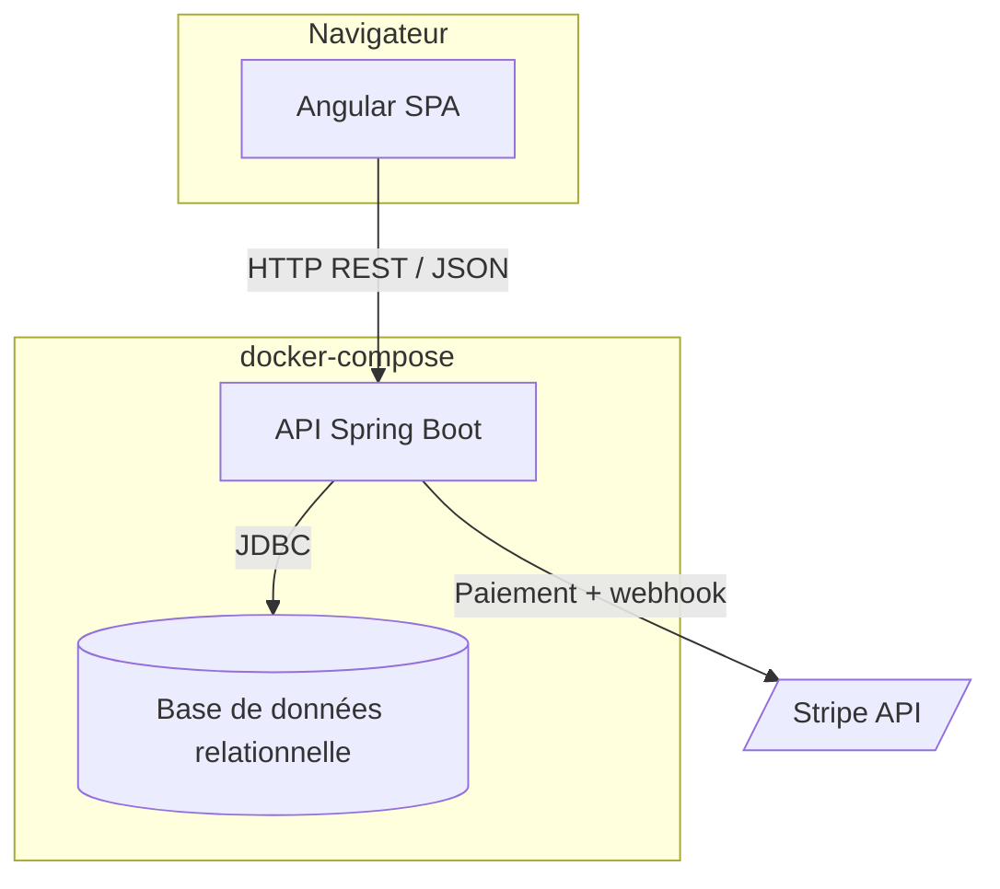
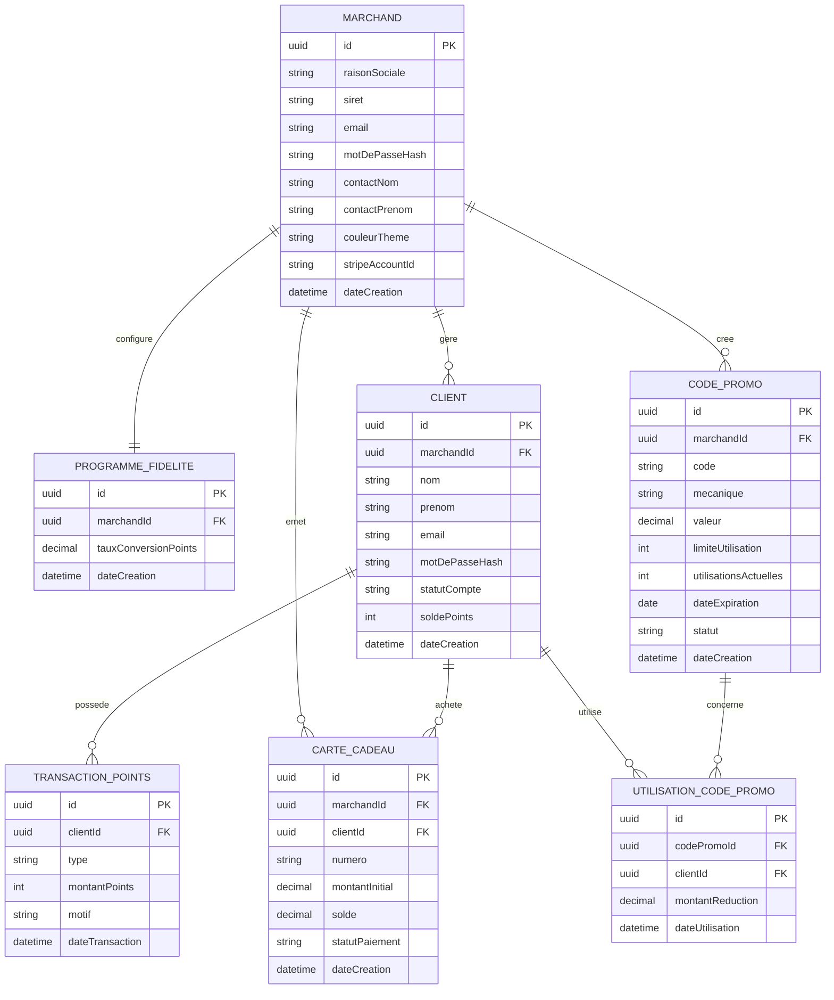

# Document de conception — PromoManager

## 1. Rappel du projet

**PromoManager** est un moteur de promotions B2B destiné aux commerces (e-commerce et boutiques physiques), édité par **Marne Tech**. Il centralise trois leviers de fidélisation client — programme de points, codes promo, cartes cadeaux — pilotables depuis un Dashboard marchand, avec un Espace Client dédié pour les clients finaux.

Le détail du besoin, du périmètre et des contraintes est formalisé dans le [cahier des charges](../Docs/cahier-des-charges.pdf).

## 2. Méthodologie de développement

Le déroulé présenté dans ce document (cahier des charges → conception → développement → tests → industrialisation) est une vue logique de la démarche, mais le développement d'une application web ou mobile moderne **n'est pas linéaire** dans les faits. Dans la pratique :

- Le projet est découpé en **sprints** (itérations courtes), chacun livrant un incrément fonctionnel testable plutôt que l'application entière d'un coup.
- Des **allers-retours avec le client** ponctuent chaque sprint : démonstration de l'incrément, retours, ajustements du périmètre ou des priorités.
- Le cahier des charges et ce document de conception sont des **points de départ, pas des contrats figés** : ils évoluent si un besoin a été mal compris au départ, si une contrainte technique impose un compromis, ou si une nouvelle idée apparaît en cours de route (ajout de fonctionnalité, suppression d'une autre).
- Les anomalies détectées en test ou en production génèrent de nouveaux tickets, traités dans un sprint suivant plutôt que de bloquer la livraison en cours.

Ce cycle itératif se traduit concrètement par le workflow Git retenu (une branche/un ticket par incrément, voir le [README](../README.md)) et par le board Kanban de suivi des issues : les ajustements et retours client y sont absorbés naturellement, sans remettre en cause la structure documentaire de ce projet.

## 3. Découpage par modules

La conception de promo manager est découpée en modules :

| Module             | Rôle                                                                                          |
| ------------------ | --------------------------------------------------------------------------------------------- |
| **Compte**         | Création du compte marchand, provisioning du compte client, authentification                  |
| **Fidélité**       | Attribution de points, taux de conversion, notifications, consultation de solde               |
| **Codes promo**    | Création, suivi, désactivation et application de codes de réduction                           |
| **Cartes cadeaux** | Génération, vente (Stripe), consultation de solde                                             |
| **Dashboard**      | Point d'entrée marchand regroupant la configuration et la supervision des 4 modules ci-dessus |

## 4. Acteurs et concepts

Promo manager reconnait deux types d'acteurs

### Acteurs

- **Marchand** — commerçant (e-commerce ou boutique physique) qui utilise PromoManager pour fidéliser sa clientèle. Il configure le programme, crée des campagnes et gère ses clients.
- **Client** — client final d'un marchand. Il bénéficie des points, codes promo et cartes cadeaux, et consulte ses avantages via l'Espace Client.

### Concepts clés

- **Point de fidélité** — unité de valeur attribuée à un client, convertie depuis un montant d'achat selon un **taux de conversion** défini par le marchand (ex. 1€ = 1 point).
- **Code promo** — code de réduction avec une **mécanique** (pourcentage, montant fixe, ou BOGO — _Buy One Get One_), une limite d'utilisation et une date d'expiration.
- **Carte cadeau** — support prépayé avec un solde, acheté par un client via Stripe, utilisable ensuite comme moyen de paiement partiel ou total.
- **Transaction (fidélité)** — événement de gain ou de dépense de points, constituant l'historique consultable par le client.

## 5. Cas d'utilisation

Un diagramme par module (voir aussi `../diagrammes/cas-utilisation/`). Pour le détail des échanges Frontend/API/DB de chaque user story, voir les diagrammes de séquence dans `../diagrammes/sequence/` (un fichier par module).

### 5.1 Module Compte

### 5.2 Module Fidélité

### 5.3 Module Codes promo

### 5.4 Module Cartes cadeaux

### 5.5 Vue globale

## 6. Stack technique

| Composant         | Choix                   |
| ----------------- | ----------------------- |
| Backend           | Java + Spring Boot      |
| Frontend          | Angular                 |
| Base de données   | SGBD relationnel        |
| Paiement          | Stripe (mode test)      |
| Conteneurisation  | Docker + docker-compose |
| CI/CD             | GitHub Actions          |
| Registre d'images | DockerHub               |

## 7. Architecture du système

- Le **frontend Angular** consomme l'API REST exposée par le backend Spring Boot (API ouverte, sans JWT).
- Le **backend** porte toute la logique métier (fidélité, codes promo, cartes cadeaux) et communique avec Stripe pour les paiements de cartes cadeaux (mode test).
- Les trois services (frontend, backend, base de données) sont orchestrés via **docker-compose** pour un déploiement reproductible.

## 8. Modèle de données

### Notes de modélisation

- `CLIENT.marchandId` : un client appartient au programme d'un seul marchand (pas de compte client partagé entre plusieurs marchands dans ce périmètre).
- `PROGRAMME_FIDELITE` : extrait de `MARCHAND` en entité séparée pour isoler les règles de fidélité (taux de conversion) du compte marchand lui-même. Relation 1-à-1 en v1 (un seul programme par marchand) ; `TRANSACTION_POINTS` reste rattachée directement à `CLIENT` plutôt qu'à `PROGRAMME_FIDELITE`, le programme actif étant retrouvé indirectement via `Client → Marchand → Programme` (pas de traçabilité historique du taux appliqué, jugée hors périmètre v1).
- `UTILISATION_CODE_PROMO` : entité d'association qui trace chaque application d'un code promo par un client, nécessaire pour respecter la limite d'utilisation et produire les statistiques de conversion.
- `CARTE_CADEAU.clientId` : nullable tant que la carte n'a pas été vendue (générée par le marchand mais pas encore achetée).

## 9. Dictionnaire de données

### MARCHAND

| Attribut        | Type         | Description                            | Contraintes      |
| --------------- | ------------ | --------------------------------------- | ---------------- |
| id              | uuid         | Identifiant unique                      | PK               |
| raisonSociale   | varchar(255) | Nom du commerce                         | NOT NULL         |
| siret           | varchar(14)  | Identifiant légal de l'entreprise       | NOT NULL, UNIQUE |
| email           | varchar(255) | Email de connexion                      | NOT NULL, UNIQUE |
| motDePasseHash  | varchar(255) | Mot de passe (haché)                    | NOT NULL         |
| contactNom      | varchar(255) | Nom du contact gérant le compte         | NOT NULL         |
| contactPrenom   | varchar(255) | Prénom du contact gérant le compte      | NOT NULL         |
| couleurTheme    | varchar(7)   | Couleur d'accent du dashboard (hex)     | NULLABLE         |
| stripeAccountId | varchar(255) | Identifiant du compte Stripe connecté   | NULLABLE         |
| dateCreation    | datetime     | Date de création du compte              | NOT NULL         |

### PROGRAMME_FIDELITE

| Attribut             | Type          | Description                         | Contraintes           |
| -------------------- | ------------- | ------------------------------------- | --------------------- |
| id                   | uuid          | Identifiant unique                  | PK                     |
| marchandId           | uuid          | Marchand propriétaire du programme  | FK → MARCHAND, UNIQUE  |
| tauxConversionPoints | decimal(10,2) | Valeur d'1 point en euros           | NOT NULL, > 0          |
| dateCreation         | datetime      | Date de création du programme       | NOT NULL               |

### CLIENT

| Attribut       | Type         | Description                                               | Contraintes                  |
| -------------- | ------------ | --------------------------------------------------------- | ----------------------------- |
| id             | uuid         | Identifiant unique                                        | PK                           |
| marchandId     | uuid         | Marchand auquel le client est rattaché                    | FK → MARCHAND                |
| nom            | varchar(255) | Nom du client                                             | NOT NULL                     |
| prenom         | varchar(255) | Prénom du client                                          | NOT NULL                     |
| email          | varchar(255) | Email de connexion                                        | NOT NULL, UNIQUE             |
| motDePasseHash | varchar(255) | Mot de passe (haché)                                      | NULLABLE tant que non activé |
| statutCompte   | varchar(20)  | `EN_ATTENTE` / `ACTIF`                                    | NOT NULL                     |
| soldePoints    | int          | Solde courant de points (dénormalisé pour lecture rapide) | NOT NULL, >= 0               |
| dateCreation   | datetime     | Date de provisioning du compte                            | NOT NULL                     |

### CODE_PROMO

| Attribut              | Type          | Description                              | Contraintes        |
| --------------------- | ------------- | ---------------------------------------- | ------------------ |
| id                    | uuid          | Identifiant unique                       | PK                 |
| marchandId            | uuid          | Marchand propriétaire du code            | FK → MARCHAND      |
| code                  | varchar(50)   | Code saisi par le client                 | NOT NULL, UNIQUE   |
| mecanique             | varchar(20)   | `POURCENTAGE` / `MONTANT_FIXE` / `BOGO`  | NOT NULL           |
| valeur                | decimal(10,2) | Valeur de la réduction (selon mécanique) | NOT NULL           |
| limiteUtilisation     | int           | Nombre d'usages maximum                  | NOT NULL, > 0      |
| utilisationsActuelles | int           | Compteur d'usages déjà effectués         | NOT NULL, défaut 0 |
| dateExpiration        | date          | Date limite de validité                  | NOT NULL           |
| statut                | varchar(20)   | `ACTIF` / `DESACTIVE`                    | NOT NULL           |
| dateCreation          | datetime      | Date de création du code                 | NOT NULL           |

### UTILISATION_CODE_PROMO

| Attribut         | Type          | Description                   | Contraintes     |
| ---------------- | ------------- | ----------------------------- | --------------- |
| id               | uuid          | Identifiant unique            | PK              |
| codePromoId      | uuid          | Code promo appliqué           | FK → CODE_PROMO |
| clientId         | uuid          | Client ayant appliqué le code | FK → CLIENT     |
| montantReduction | decimal(10,2) | Montant réellement déduit     | NOT NULL        |
| dateUtilisation  | datetime      | Date d'application            | NOT NULL        |

### CARTE_CADEAU

| Attribut       | Type          | Description                | Contraintes           |
| -------------- | ------------- | -------------------------- | --------------------- |
| id             | uuid          | Identifiant unique         | PK                    |
| marchandId     | uuid          | Marchand émetteur          | FK → MARCHAND         |
| clientId       | uuid          | Client acheteur            | FK → CLIENT, NULLABLE |
| numero         | varchar(50)   | Numéro visible de la carte | NOT NULL, UNIQUE      |
| montantInitial | decimal(10,2) | Montant initial chargé     | NOT NULL, > 0         |
| solde          | decimal(10,2) | Solde restant disponible   | NOT NULL, >= 0        |
| statutPaiement | varchar(20)   | Statut du paiement Stripe  | NOT NULL              |
| dateCreation   | datetime      | Date de génération         | NOT NULL              |

### TRANSACTION_POINTS

| Attribut        | Type         | Description                        | Contraintes |
| --------------- | ------------ | ---------------------------------- | ----------- |
| id              | uuid         | Identifiant unique                 | PK          |
| clientId        | uuid         | Client concerné                    | FK → CLIENT |
| type            | varchar(10)  | `GAIN` / `DEPENSE`                 | NOT NULL    |
| montantPoints   | int          | Nombre de points de la transaction | NOT NULL    |
| motif           | varchar(255) | Origine de la transaction          | NOT NULL    |
| dateTransaction | datetime     | Date de l'événement                | NOT NULL    |
