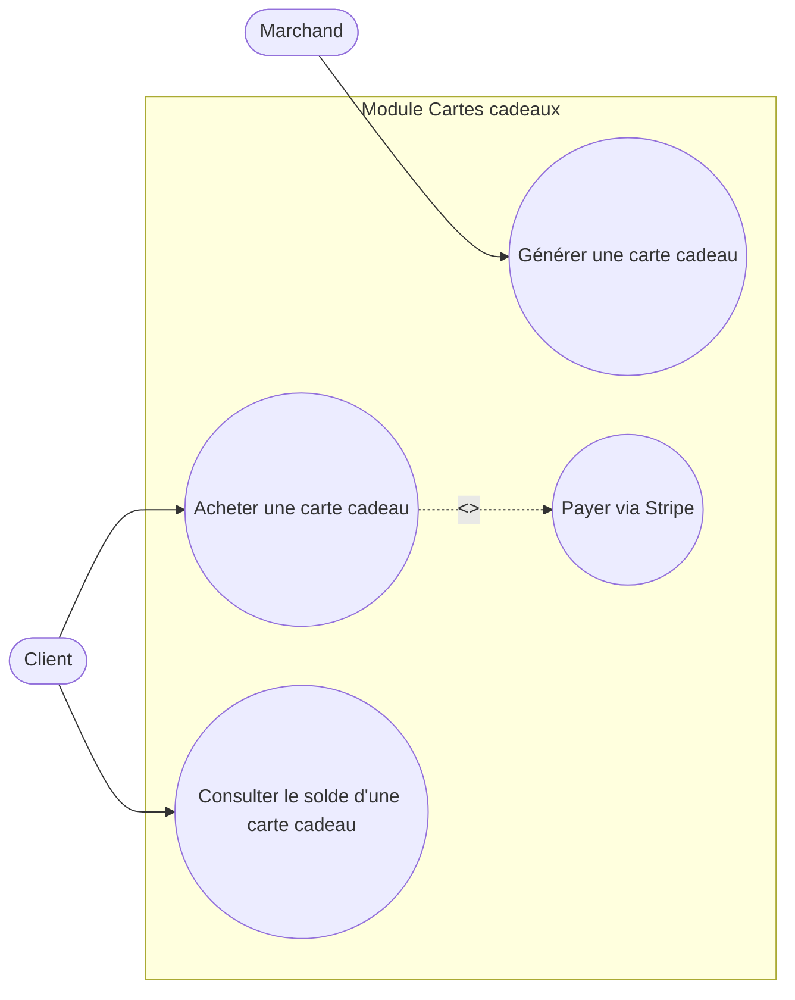

# Diagramme de cas d'utilisation — Module Cartes cadeaux

`<<include>>` : acheter une carte cadeau implique systématiquement un paiement Stripe — c'est une sous-étape obligatoire du flux, pas une action séparée.
