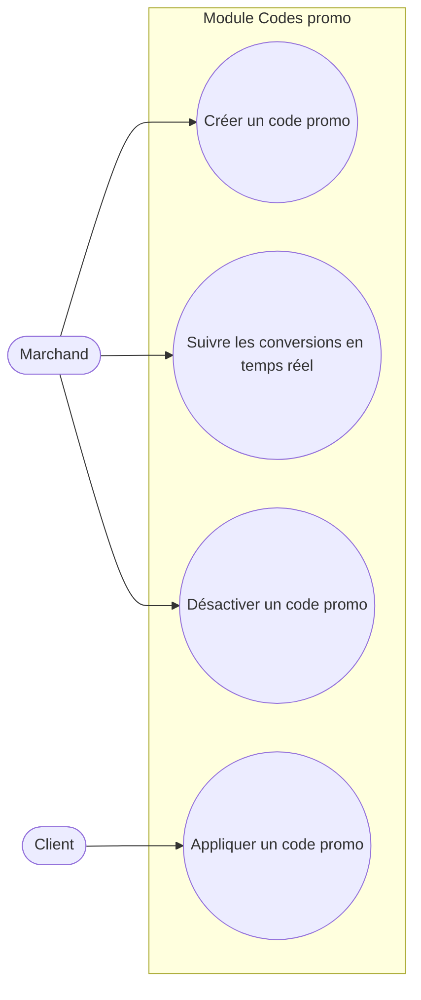

# Diagramme de cas d'utilisation — Module Codes promo

Pas de relation `<<include>>`/`<<extend>>` forcée ici : les 4 cas sont indépendants (créer, suivre, désactiver sont des actions marchand autonomes ; appliquer est une action client autonome, simplement contrainte par l'état du code au moment de la vérification).
