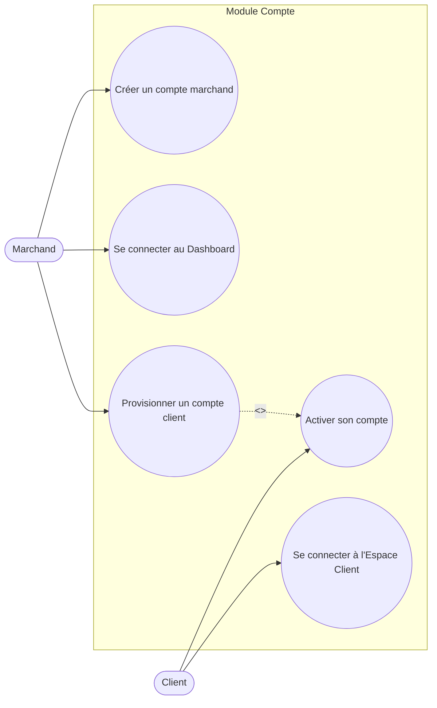

# Diagramme de cas d'utilisation — Module Compte

Hypothèse retenue : le Marchand crée son propre compte (self-service). Le compte Client, lui, est **provisionné par le Marchand** (ex. lors d'une première attribution de points) ; le Client active ensuite son accès et se connecte.

