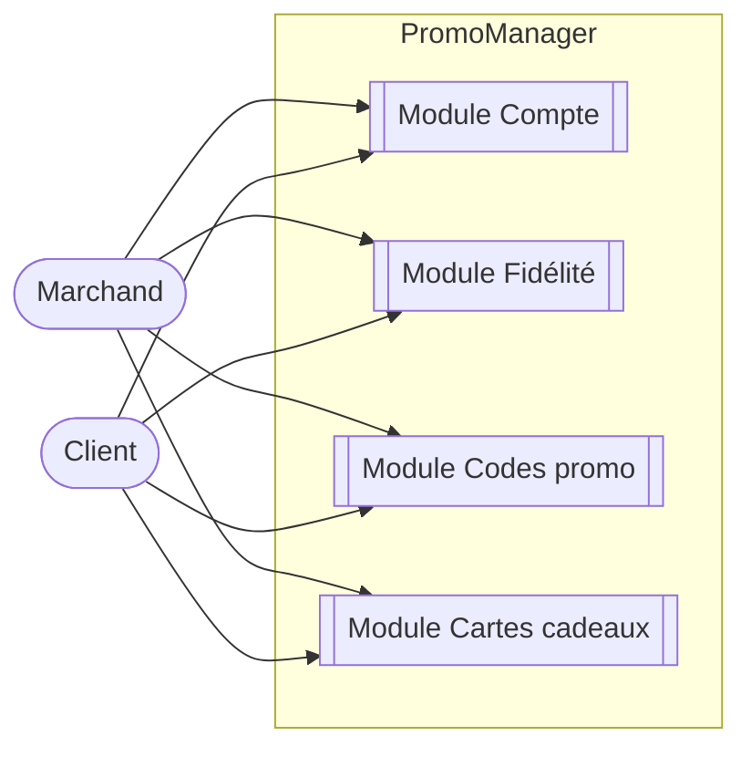

# Diagramme de cas d'utilisation — Vue globale (synthèse)

Vue de synthèse reliant les acteurs aux modules. Chaque module est détaillé dans son propre diagramme (`compte.md`, `fidelite.md`, `codes-promo.md`, `cartes-cadeaux.md`).

Nouvelle forme utilisée ici : `[[Texte]]` (sous-routine) pour représenter un module entier comme un bloc fonctionnel, plutôt qu'un cas d'utilisation unitaire (`((Texte))`).
