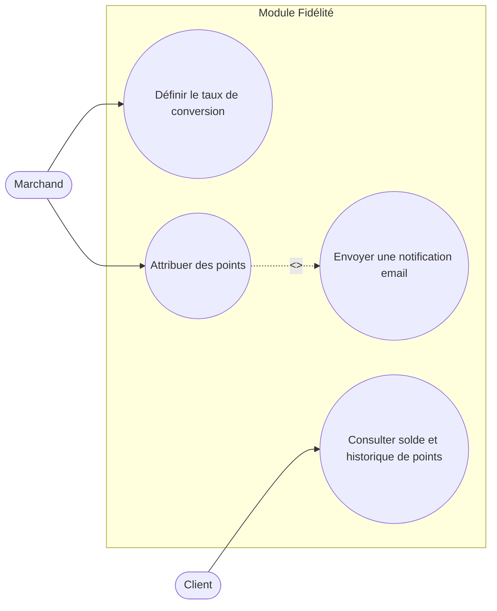

# Diagramme de cas d'utilisation — Module Fidélité

`<<include>>` : l'attribution de points déclenche systématiquement l'envoi de la notification email — ce n'est pas une action séparée que l'acteur choisit, elle fait partie du flux de "Attribuer des points".
