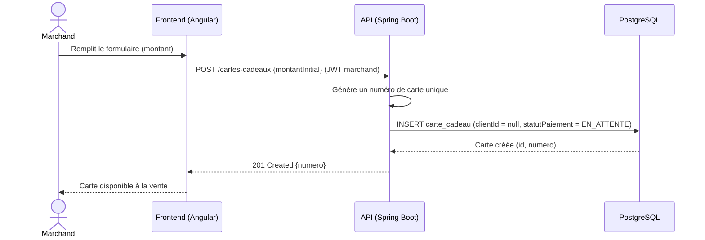
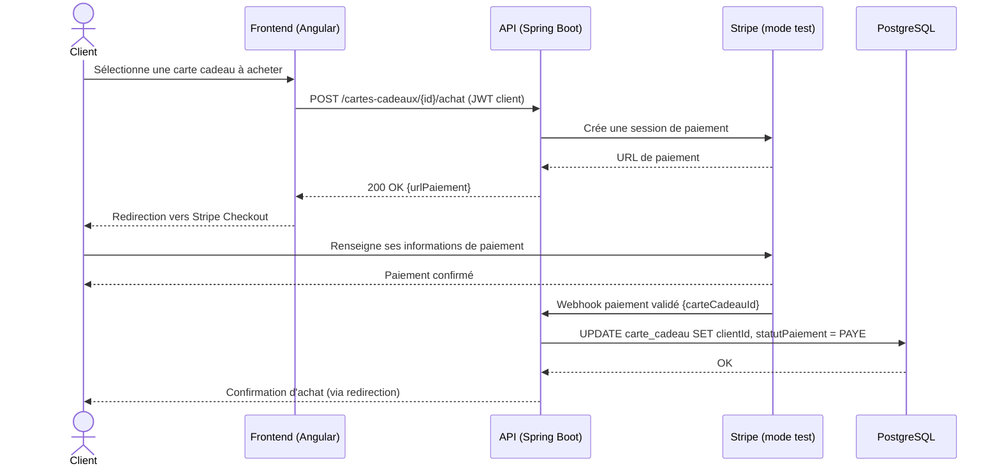
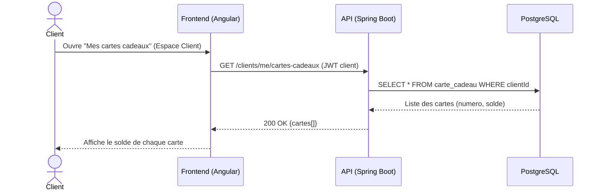

# Diagrammes de séquence — Module Cartes cadeaux

Un diagramme par user story (voir aussi `../../Docs/cahier-des-charges-v2.md`, § 7.3).

## US-CADO-01 — Génération d'une carte cadeau

## US-CADO-02 — Achat d'une carte cadeau en payant via Stripe

`<<include>>` : l'achat d'une carte cadeau implique systématiquement un paiement Stripe — c'est une sous-étape obligatoire du flux, matérialisée ici par l'échange avec Stripe et son webhook de confirmation.

## US-CADO-03 — Consultation du solde d'une carte cadeau

