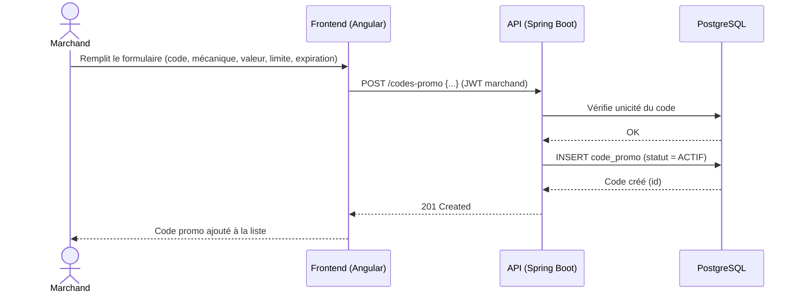
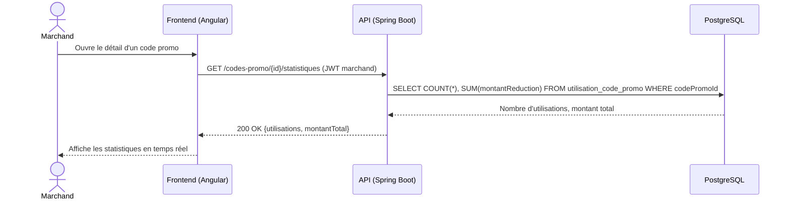
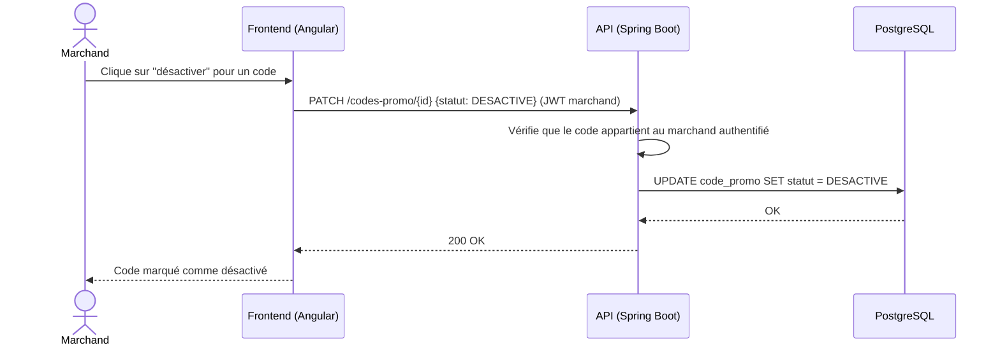
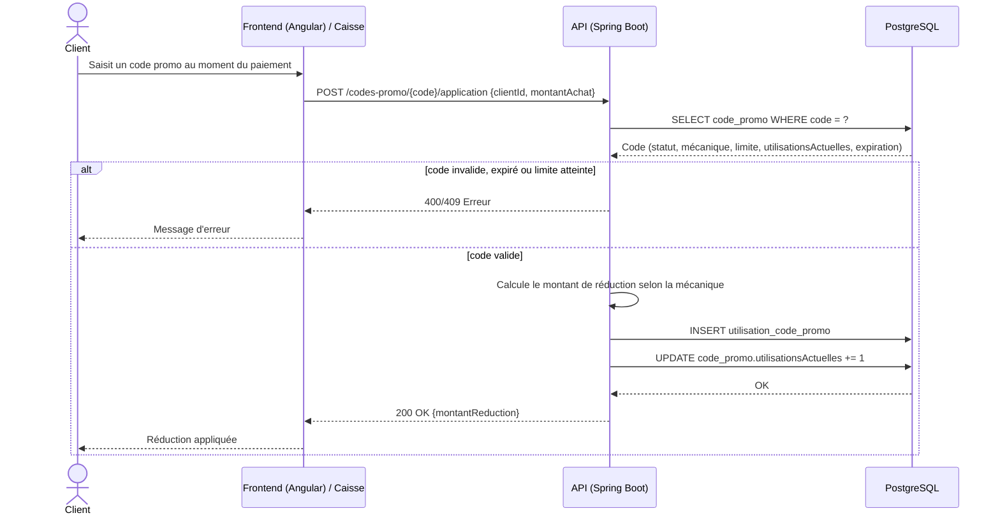

# Diagrammes de séquence — Module Codes promo

Un diagramme par user story (voir aussi `../../Docs/cahier-des-charges-v2.md`, § 7.3).

## US-PROMO-01 — Création d'un code promo

## US-PROMO-02 — Suivi des conversions en temps réel

## US-PROMO-03 — Désactivation d'un code promo

## US-PROMO-04 — Application d'un code promo

