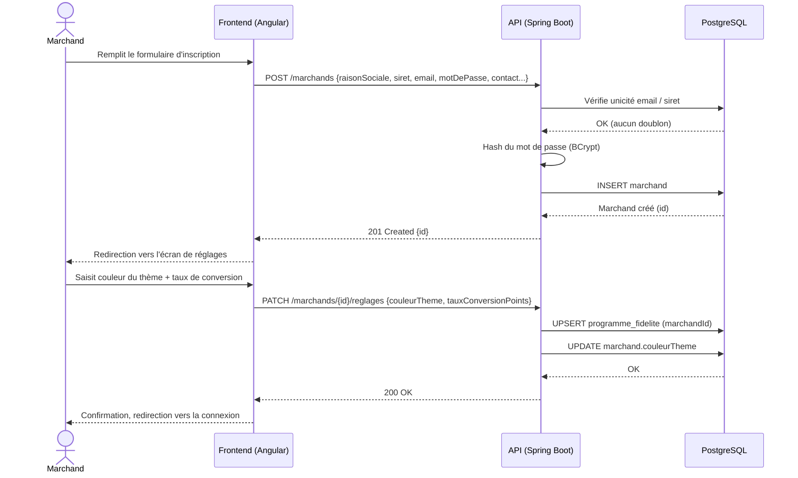
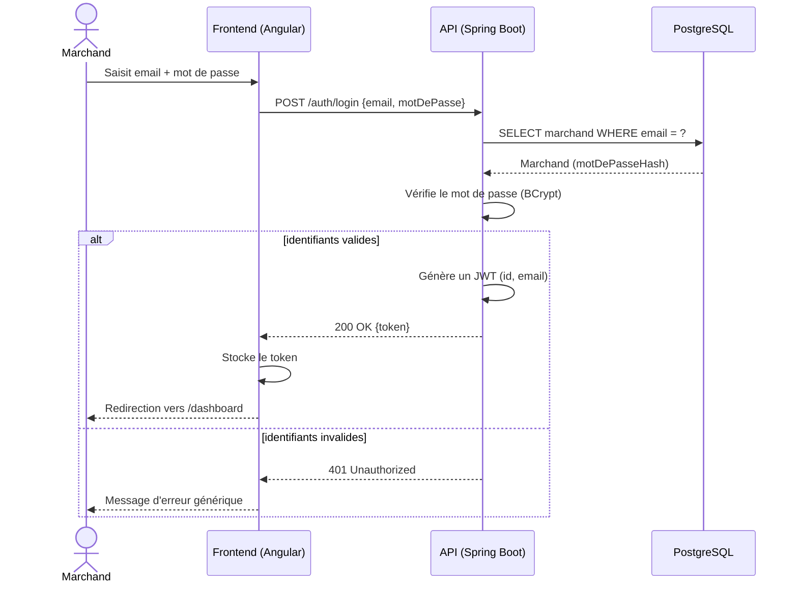
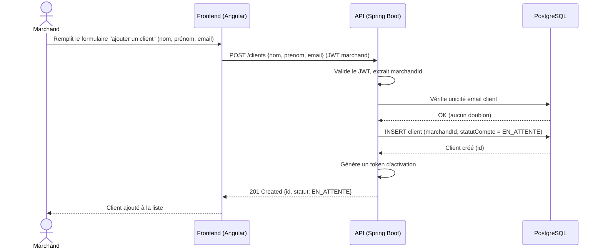
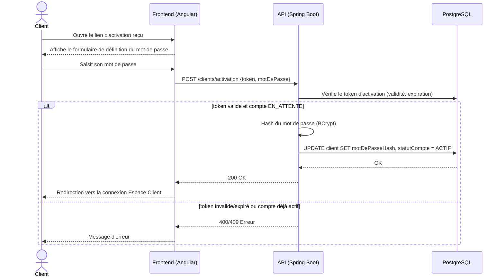
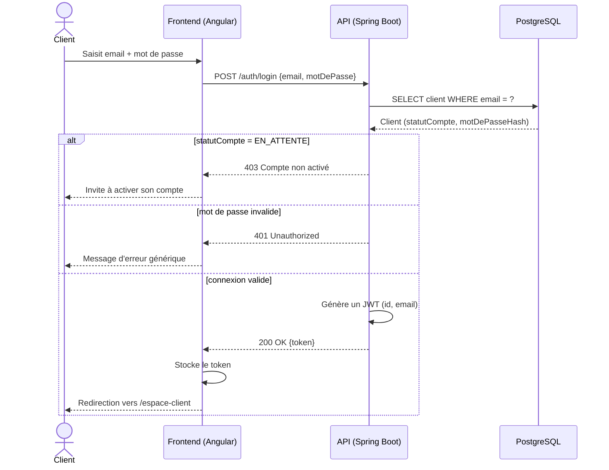

# Diagrammes de séquence — Module Compte

Un diagramme par user story (voir aussi `../../Docs/cahier-des-charges-v2.md`, § 7.3).

## US-CPT-01 — Création de compte marchand + réglages globaux

## US-CPT-02 — Connexion au Dashboard

## US-CPT-03 — Provisionnement de compte client

## US-CPT-04 — Activation de compte client

## US-CPT-05 — Connexion à l'Espace Client

