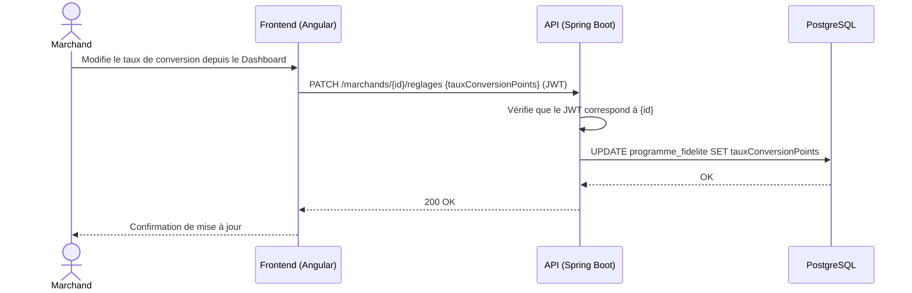
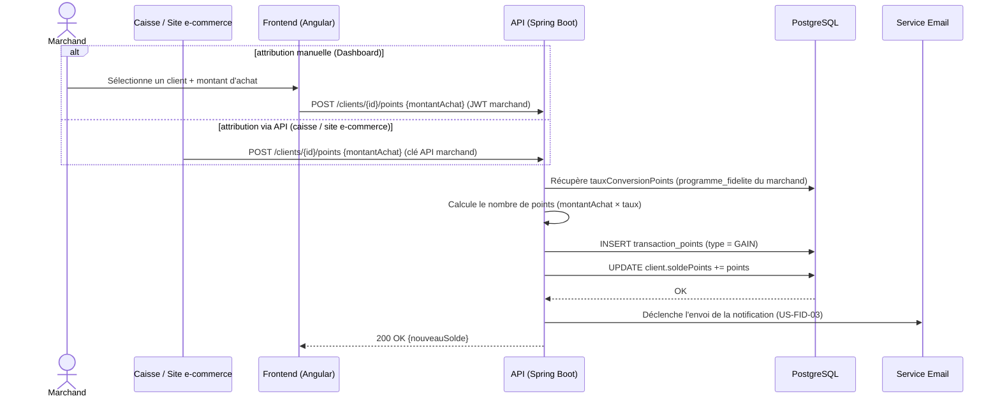
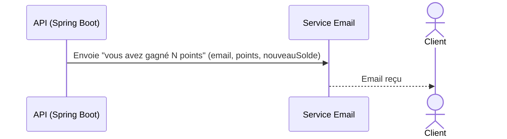
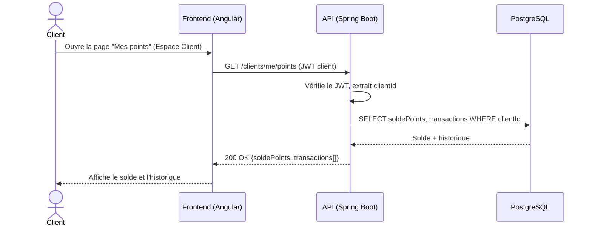

# Diagrammes de séquence — Module Fidélité

Un diagramme par user story (voir aussi `../../Docs/cahier-des-charges-v2.md`, § 7.3).

## US-FID-01 — Définition du taux de conversion

## US-FID-02 — Attribution de points (manuelle ou via API)

`<<include>>` : l'attribution déclenche systématiquement l'envoi de la notification email (US-FID-03), reprise séparément ci-dessous pour la lisibilité du flux d'envoi.

## US-FID-03 — Notification email automatique

## US-FID-04 — Consultation solde et historique de points

